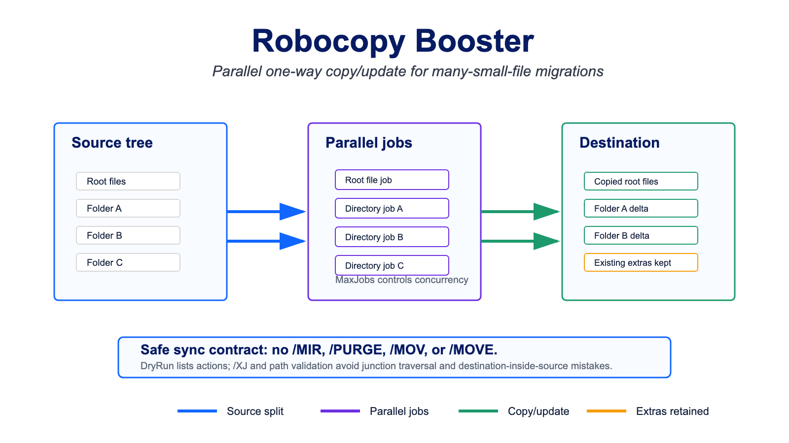

# Warning

**Important Notice:**

This repository is published publicly as a resource for other Azure NetApp Files (ANF) and Azure specialists. However, please be aware of the following:

1. **Unofficial Content:** Nothing in this repository is official, supported, or fully tested. This content is my own personal work and is not warranted in any way.
2. **No Endorsement:** While I work for NetApp, none of this content is officially from NetApp nor Microsoft, nor is it endorsed or supported by NetApp or Microsoft.
3. **Use at Your Own Risk:** Please use good judgment, test anything you'll run, and ensure you fully understand any code or scripts you use from this repository.

By using any content from this repository, you acknowledge that you do so at your own risk and that you are solely responsible for any consequences that may arise.

# Robocopy Booster

Robocopy Booster accelerates large migrations containing many small files by running Robocopy jobs in parallel. Each top-level source directory becomes a separate job, and root-level source files are copied as one additional job.

## Download

[Download robocopy-booster.ps1](https://github.com/tvanroo/public-anf-toolbox/blob/main/Robocopy%20Booster/robocopy-booster.ps1)

This is the single canonical script. The former V2 experiment was consolidated into this stable filename and removed.

## Sync Contract

Robocopy Booster is a one-way source-to-destination copy/update tool.

- Source data is not deleted, moved, renamed, or purged.
- The script does not use Robocopy /MOV, /MOVE, /MIR, or /PURGE.
- Source and destination are required and must be separate, non-overlapping FileSystem directory trees.
- Existing reparse points, junctions, and symlinks in the source or destination path are blocked.
- Each generated top-level job root is rechecked immediately before its job starts.
- Path overlap checks compare the resolved path strings. You must also verify that different drive mappings, DFS paths, UNC names, or server aliases do not refer to overlapping physical storage.
- Top-level source reparse directories are skipped, and Robocopy runs with /XJ for junctions encountered below each job root.
- The destination is created if it does not exist, unless -DryRun is used.
- New or changed source files may create or overwrite destination files.
- Extra destination files are left in place. This is not a mirror or purge tool.

## First Run and Reruns

On the first run, the script validates Robocopy and the requested paths, copies source root files to the destination root, and copies every non-reparse top-level directory in parallel.

On later passes:

- Matching files are skipped.
- New and changed source files are copied.
- Files deleted from the source remain at the destination.
- Extra destination files remain in place.

This behavior supports repeated catch-up passes before a final migration cutover while keeping the source unchanged.

## Example Usage

Run a dry run first:

    .\robocopy-booster.ps1 -SourcePath "\\old-file-server\profiles" -DestinationPath "\\anf-smb-volume\profiles" -DryRun

Run a copy/update pass with the conservative defaults:

    .\robocopy-booster.ps1 -SourcePath "\\old-file-server\profiles" -DestinationPath "\\anf-smb-volume\profiles"

Write one full Unicode Robocopy log per job:

    .\robocopy-booster.ps1 -SourcePath "\\old-file-server\profiles" -DestinationPath "\\anf-smb-volume\profiles" -LogDirectory "D:\MigrationLogs\profiles-pass-1"

Tune concurrency only after measuring the defaults:

    .\robocopy-booster.ps1 -SourcePath "\\old-file-server\profiles" -DestinationPath "\\anf-smb-volume\profiles" -MaxJobs 8 -ThreadsPerJob 16

## Parameters

| Parameter | Default | Description |
| --- | --- | --- |
| -SourcePath | Required | Source directory. Alias: -src. |
| -DestinationPath | Required | Destination directory. Alias: -dest. |
| -MaxJobs | 4 | Maximum parallel Robocopy jobs. Alias: -max_jobs. |
| -ThreadsPerJob | 8 | Robocopy /MT threads per job. Aliases: -mtreads, -mtThreads, and -mthreads. |
| -RetryCount | 1 | Robocopy /R retry count. |
| -WaitSeconds | 1 | Robocopy /W wait time between retries. |
| -LogDirectory | Not enabled | Writes one full Unicode Robocopy log per job. The directory must be outside the source and destination trees. Filenames include a unique run identifier so later passes do not overwrite earlier logs. |
| -DryRun | Off | Adds Robocopy /L so actions are listed without writing to the destination. |

During a dry run without -LogDirectory, Robocopy lists the planned files and directories in the console. During a live pass without -LogDirectory, the script suppresses per-file and per-directory lists but keeps each Robocopy job summary. With -LogDirectory, full output is redirected to unique per-job /UNILOG files and the console retains the booster progress and result summary.

If -LogDirectory does not exist, the script creates it even during a dry run. A dry run does not create or write to the destination.

## Concurrency

The maximum number of simultaneous Robocopy copy threads is:

    minimum(number of work items, MaxJobs) × ThreadsPerJob

The defaults allow at most 32 active copy threads. The script warns when the configured aggregate exceeds two threads per logical processor. That threshold is general guidance, not an automatic performance target; benchmark while watching CPU, SMB sessions, network throughput, and source/destination latency.

## Copy Metadata

The script uses /COPY:DAT and /DCOPY:DAT. It preserves file and directory data, attributes, and timestamps.

It does not copy ACLs, owners, or auditing information. If the migration requires security metadata, use a separately reviewed command and validate the required permissions at both endpoints.

## Exit Codes

Each job records its Robocopy exit code. The script returns:

- 0 when every job returns a Robocopy exit code below 8.
- 1 when any job returns 8 or higher, validation fails, or a background job fails to return a valid result.

Robocopy exit-code ranges:

- 0-3: Normal success states.
- 4-7: Warning states, often including extras or mismatches.
- 8 or higher: Failure states.

## Best Practices

- Start with -DryRun against the real source and destination paths.
- Keep logs outside both trees and retain them through cutover validation.
- Start with the default 4 jobs and 8 threads per job, then benchmark before increasing either value.
- Run several delta passes and review warning or error jobs before cutover.
- Avoid using a drive root as the source; Robocopy can propagate hidden and system attributes from a device root to the destination.
- Validate the result on Windows against representative SMB data before using it for a production migration.

## Important Limitations

- Windows with Robocopy and Windows PowerShell 5.1 or PowerShell 7 is required.
- The local checks validate PowerShell syntax and safety invariants; they are not a substitute for endpoint-specific Windows and SMB acceptance testing.
- Reparse-point path aliases are rejected. Use direct FileSystem paths.
- The script parallelizes by top-level source directory, so performance is best when data is spread across multiple reasonably balanced directories.
- No destination cleanup is performed. Use a separate, carefully reviewed process if true mirror semantics are required.

## Upgrading from V2

Replace robocopy-booster-v2.ps1 with robocopy-booster.ps1. The old -EnableLogging experiment was removed: use -LogDirectory for durable, per-job logs. Locale-dependent speed parsing was intentionally dropped.

## Upgrading the Existing Canonical Script

The stable robocopy-booster.ps1 filename is unchanged, but its safer defaults are intentionally different:

- -SourcePath and -DestinationPath are now mandatory; the write-active Z:\ and C:\txtest defaults were removed.
- Default concurrency changed from 12 jobs × 128 threads to 4 jobs × 8 threads.
- Live runs show concise job summaries by default instead of full per-file output. Use -LogDirectory for full, durable output.
- Source-inside-destination paths, reparse-point ancestors, and reparse-point job roots are now rejected.
